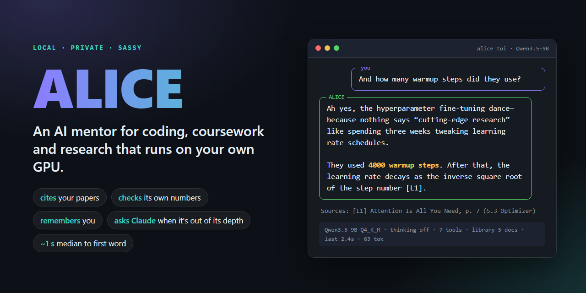
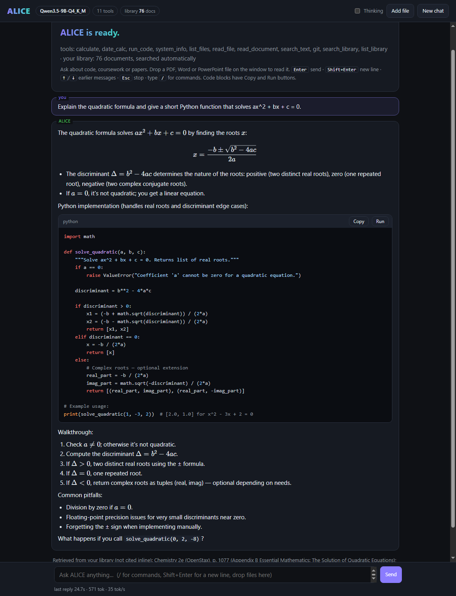

# ALICE

A locally run AI mentor with a personality, for **coding, coursework and research** in computer science and
AI. She gives you the full solution first, walks you through it step by step, and finishes study answers with
one concrete question to check you got it. Casual chat gets a casual reply, with no quiz. Expect a little sass
about the topic, never about you. Bachelor thesis project;
the running notes, measurements and decisions are in [docs/DEVLOG.md](docs/DEVLOG.md).



## What she does

- **Runs on your own GPU.** Qwen3.5-9B through llama.cpp. Conversations, papers and memory stay on your
  computer.
- **Answers from your papers.** `alice ingest` adds PDFs and notes to a local library (hybrid vector +
  keyword search). Answers cite passages as `[L1]`, and ALICE warns about citations that were never retrieved
  and about numbers that aren't in the cited passages. Nicknames like "the ResNet paper" work.
- **Checks her own work.** A calculator for every non-trivial number, a check that the final answer matches
  it, and a warning when a reply claims a search or test run that never happened.
- **Runs code.** Python, C, C++ and Java, to test code before she shows it to you. Each run is shown to you
  and needs your OK. Every code block in the desktop window has its own Run button, with a box for the
  program's input.
- **Has her own window.** Maths is typeset, code is highlighted, and files can be dropped on the window to be
  read. The terminal chat box is still there if you prefer it.
- **Stays honest about what she doesn't know.** Unknown papers or methods get "I don't know this one" instead
  of a confident made-up summary. She then looks it up with her arXiv tool, or does that automatically before
  answering if you turn on `/arxiv auto on`.
- **Remembers you.** Long conversations are compacted instead of forgotten. Facts you mention about yourself
  (courses, projects, deadlines, how you like explanations) are saved locally and used in later sessions.
  Facts that aren't backed by your own words are rejected.
- **Knows when to ask for help.** When her answer fails one of the checks, ALICE offers to pass the question
  to Claude (optional, opt-in). You see exactly what would be sent and what it costs before anything leaves
  your computer.
- **Fast enough to talk to.** About 1 s median to the first word in a multi-turn chat. That's down from 21 s
  before prompt caching was fixed: see the 2026-11-19 entry in the devlog.

## Quick start (Windows)

1. Get the llama.cpp CUDA build into `tools/llama.cpp/` (see the devlog, Phase 0), then the models:
   `bash scripts/download_models.sh` (Qwen3.5-9B Q4_K_M 5.7 GB + Qwen3-Embedding-0.6B 0.6 GB).
2. Python 3.11+:
   ```
   python -m venv .venv
   .venv\Scripts\python -m pip install -e ".[dev,gui]"      # add ,claude for /claude: ".[dev,gui,claude]"
   ```
3. Optional, for C, C++ and Java: `.venv\Scripts\python scripts\setup_toolchains.py`. This puts a portable
   GCC (WinLibs) and JDK 21 (Microsoft OpenJDK) into `tools/`, about 0.5 GB, checksum-verified. Python code
   runs without it.
4. Chat:
   ```
   .venv\Scripts\alice gui                   # desktop window; starts the model itself
   .venv\Scripts\alice tui                   # chat box in the terminal
   .venv\Scripts\alice                       # line-based chat (same options)
   ```

## Use

```
.venv\Scripts\alice gui --browser         # the same interface in your default browser instead of a window
.venv\Scripts\alice tui --think           # thinking mode on (slower, best at maths and logic)
.venv\Scripts\alice tui --workspace C:\code\proj   # let ALICE read files in that folder (default: current dir)
.venv\Scripts\alice tui --offline         # no internet tools (arXiv)
.venv\Scripts\alice tui --no-memory       # don't load or save long-term memory this session
.venv\Scripts\alice tui --claude          # allow /claude this session (needs an Anthropic API key)
.venv\Scripts\alice ingest papers\        # add PDF / Word / PowerPoint / .md / .txt files to your library
.venv\Scripts\alice library               # list library documents (--remove ID, --retitle ID TITLE)
```

The options work for all three front ends.

**Desktop window.**
- **Writing:** Enter sends, Shift+Enter starts a new line, Up/Down brings back earlier messages, and `/` lists
  the commands.
- **Stopping:** Esc stops a reply.
- **Files:** drop a PDF, Word or PowerPoint file on the window, or use **Add file**.
- **Code blocks:** each has **Copy** and **Run**. Run opens a box for the program's input, and the output
  appears underneath while the program runs. Run turns into **Stop** while it's running.
- **When ALICE wants to run code herself,** the window shows you the code and its input first. If you approve,
  the program gets its own panel in the chat: output appears live (errors in red), then the exit code.
- **Open in terminal** (on both panels) runs the program in its own console window. Use it for programs
  you want to type into yourself.
- **Header:** **Thinking** switches step-by-step reasoning, **Ask Claude** (when Claude escalation is on)
  passes the last question on, and **New chat** starts over.

The window uses Windows' built-in WebView2. It only listens on 127.0.0.1, behind a random per-session token.

**Chat box keys.**
- Sending and editing: Enter sends, Shift+Enter starts a new line, Up/Down brings back earlier messages.
- During a reply: Esc stops it. The status line shows what ALICE is doing and for how long.
- Answers: Ctrl+O copies the last answer. Ctrl+G asks Claude.
- Chat: Ctrl+T toggles thinking, Ctrl+R starts a new conversation, Ctrl+L clears the screen, PgUp/PgDn
  scrolls, Ctrl+Q quits.

Typing `/` shows the commands. Use Windows Terminal or the VS Code terminal (the old console window renders
it poorly).


**Commands (both chats).**

| Command | What it does |
|---|---|
| `/think on\|off` | step-by-step reasoning |
| `/arxiv auto on\|off` | automatic arXiv lookup for named papers |
| `/read PATH [question]` | read a PDF, Word (`.docx`) or PowerPoint (`.pptx`) file; `/read off` closes it |
| `/claude [question]` | pass the last question, or a new one, to Claude |
| `/memory` | show what ALICE remembers about you |
| `/remember TEXT` | add a note to long-term memory |
| `/forget ID\|all` | delete memory notes |
| `/copy [code]` | copy the last answer or its last code block (chat box only) |
| `/tools` | list the tools |
| `/reset` | start a new conversation |
| `/help` | show the commands |
| `/quit` | leave |

**Tools.** ALICE always knows the current date and local time; that needs no tool.
- `calculate`
- `date_calc`: days until a deadline, the weekday of a date, a date N days from now
- `run_code`: Python, C (C17), C++ (C++20) or Java, with optional input. It asks before every run, and has a
  20 s limit and a minimal environment. You see the program's output live in every chat (a panel in the
  window, a box in the chat box, framed lines in the line chat), and Esc stops it.
- `system_info`: your OS, Python, CPU, RAM, GPU and VRAM in use, free disk, and versions of common dev tools
- `list_files` / `read_file` / `search_text` / `read_document` (PDF, Word, PowerPoint): read-only, and only
  inside the workspace
- `git`: read-only status, diff, log and show for the workspace repository
- `arxiv_search` / `arxiv_paper`: use the internet
- `search_library` / `list_library`: available once your library has documents

### Your documents

Give ALICE a PDF, Word or PowerPoint file in the middle of a chat. Use `/read C:\path\to\slides.pptx
what's on the exam?`, or just drag the file into the terminal (or paste its path) and press Enter.
- **Short documents** (up to about 14,000 characters) go into the conversation whole.
- **Longer documents** stay open, and each question gets the most relevant pages or slides. ALICE says which
  page or slide she used. `/read off` closes the document.
- **What's read:** Word headings, lists and tables; PowerPoint slides in order, with speaker notes.
- **Old formats:** binary `.doc` and `.ppt` files need saving as `.docx`, `.pptx` or PDF first. Scanned PDFs
  need OCR.

`alice ingest` also accepts `.docx` and `.pptx`, so documents you'll come back to can be added to the library
permanently.

### Starter library

`scripts/build_library.py` downloads and ingests a starter library:

| Subject | What's in it |
|---|---|
| AI and ML papers (44, from arXiv) | Optimisation tutorials, vision, NLP and Transformers, LLMs, generative models, RL, graphs, interpretability, fairness |
| Maths textbooks | Calculus 1–3, Introductory Statistics and Contemporary Mathematics (OpenStax); Interactive Linear Algebra (Georgia Tech); Linear Algebra (UC Davis); *Notes on Diffy Qs* (Lebl); MIT's *Mathematics for Computer Science* |
| Programming textbooks | Introduction to Computer Science, Python and Data Science (OpenStax); *Think Python 2e*; *Beej's Guide to C* |
| Physics and engineering textbooks | University Physics 1–3 (OpenStax); *Lessons in Electric Circuits* I–IV (DC, AC, semiconductors, digital); *Engineering Statics*; Additive Manufacturing Essentials (OpenStax) |
| Chemistry and biology textbooks | Chemistry 2e, Organic Chemistry and Biology 2e (OpenStax) |
| Writing and ethics | Writing Guide with Handbook and Business Ethics (OpenStax) |
| Landmark open papers | LIGO, AlphaFold, neural message passing for chemistry, Tao's "What is good mathematics?" |

The textbooks cover a typical first-year engineering programme:
- linear algebra and differential equations
- single and multivariable calculus
- C and Python programming
- the aptitude topics: counting, probability and logic
- circuits and electronics
- statics
- engineering physics and chemistry

Some courses have no open textbook that a script can download. These are environmental science, technical
communication, the Constitution of India, Kannada and engineering graphics. Their hosts refuse automated
downloads, or there is no open text at all. Download your own course material in a browser and add it with
`alice ingest`.

Every arXiv ID is checked against arXiv before downloading. The PDFs stay in `data/papers/`, which is
gitignored: the licences (CC BY-NC-SA and similar) allow personal study, not redistribution.

For books, section names come from the PDF's bookmarks. Sources then read, for example, "Chemistry 2e,
p. 1077 (Appendix B Essential Mathematics: The Solution of Quadratic Equations)".

```
.venv\Scripts\python scripts\build_library.py --dry-run     # check the list, download nothing
.venv\Scripts\python scripts\build_library.py               # download + ingest (re-runs skip what's there)
.venv\Scripts\python scripts\build_library.py --no-books    # papers only (the textbooks are 5-220 MB each)
.venv\Scripts\python scripts\build_library.py --reingest-books   # also redo books ingested by older versions
```

Stop ALICE before running it: embedding uses the GPU. The textbooks take a few minutes each.

### Memory

ALICE keeps notes in `data/memory/memory.db`, on your computer only. Notes are written in three situations:
- when a long conversation is compacted (the oldest turns are summarised to keep the rest in context)
- on `/reset`
- when the chat closes, which takes a few seconds; Ctrl+C skips it

A note is either something you said about yourself, or a short summary of what a conversation covered. The
newest notes are loaded at the next start.

You stay in control: `/memory` lists the notes, `/forget` deletes them, and `--no-memory` or
`[memory] enabled = false` turns memory off.

### Claude escalation (optional)

For questions the local model is too weak for, ALICE can hand over to Claude. It is off unless you turn it on.
1. Install the extra: `pip install -e ".[claude]"`.
2. Set `ANTHROPIC_API_KEY`.
3. Set `[claude] enabled = true` in `alice.toml`, or start ALICE with `--claude`.

How it works:
- **Suggestion.** When an answer fails a check, ALICE says why and suggests `/claude`. These checks are
  citations that were never retrieved, numbers that aren't in the cited passages, a calculator mismatch, a
  claimed search that never happened, a tool loop, or "I don't know this paper".
- **Confirmation.** `/claude` (or Ctrl+G) shows exactly what would be sent and an estimated cost, and asks
  first. Paths, e-mail addresses and anything that looks like a key are redacted, and memory notes are never
  sent.
- **Answer.** Claude answers in ALICE's voice, and the conversation then continues locally.
- **Usage log and budget.** Usage goes to `logs/claude_usage.jsonl`: tokens, cost and the reason, never
  message text. A monthly budget, $5 by default, is enforced from that log.
- **Model.** The default is `claude-opus-5-5` at `effort = "high"`, with Anthropic's refusal fallback
  enabled.

## Configuration and hardware upgrades

All hardware-specific settings live in `alice.toml`, which is not committed. Start from the example:
`copy alice.example.toml alice.toml`. The defaults target a small consumer GPU: Qwen3.5-9B at 16k context,
with the embedder on the CPU.

To upgrade:
1. Download the bigger model into `models/` and add a profile, e.g. `[models.big]` with `gguf`, `ctx`, `ngl`
   and `extra_args`. Then set `[chat] profile = "big"`, or run `alice --model big`.
2. With spare VRAM or unified memory, set `[embedding] device = "gpu"`.
3. If you change the embedding model, run `alice library --rebuild`, then
   `python scripts/calibrate_retrieval.py`, and copy the suggested thresholds into `[embedding]`. ALICE
   refuses to mix embedding models in one library and tells you when a rebuild is needed.

ALICE works on Windows, macOS and Linux (llama.cpp's `llama-server`; `.exe` is added automatically on
Windows).

The paper library uses exact vector search plus SQLite FTS5. In `scripts/scale_bench.py` one search took
about 19 ms at 100k chunks (about 1,000 papers) and about 185 ms at 1M chunks (about 10,000 papers).

## Privacy

Everything runs locally, with two optional exceptions:
- the arXiv tools, which send the search text to arxiv.org
- `/claude`, which sends what it showed you to Anthropic, and only after you say yes

The desktop window loads nothing from the internet, because its scripts and fonts are bundled.

Your data stays in gitignored folders:
- sessions in `logs/transcripts/`
- the library in `data/library/`
- memory in `data/memory/`
- files dropped on the window in `data/uploads/`
- programs opened in a console window in `data/runs/`, deleted after a day

## Tests and evaluations

```
.venv\Scripts\python -m pytest                                   # unit + headless UI tests (no model needed)
.\scripts\bench.ps1 -Model Qwen3.5-9B-Q4_K_M                     # raw speed (llama-bench)
.venv\Scripts\python scripts\latency_bench.py --tag NAME          # time to first token in a real conversation
.venv\Scripts\python scripts\memory_eval.py                       # memory: planted facts stored and used
.venv\Scripts\python scripts\phase1_check.py                      # numeric accuracy + opener variety
set ALICE_LIBRARY=data\eval_library
.venv\Scripts\alice ingest data\eval_papers                       # 5 arXiv papers (download: see DEVLOG)
.venv\Scripts\python scripts\rag_eval.py --set famous             # retrieval + grounded answers (also: 2026, alias, calc)
.venv\Scripts\python scripts\scale_bench.py                       # vector search at 10k-1M chunks
.venv\Scripts\python scripts\calibrate_retrieval.py --set 2026    # thresholds for the embedding model
.venv\Scripts\python scripts\readme_screenshot.py                 # the chat-box screenshot, from the real model
```

## Contributing

This is a personal thesis project, so pull requests aren't accepted. You're welcome to read the code and the
devlog.
