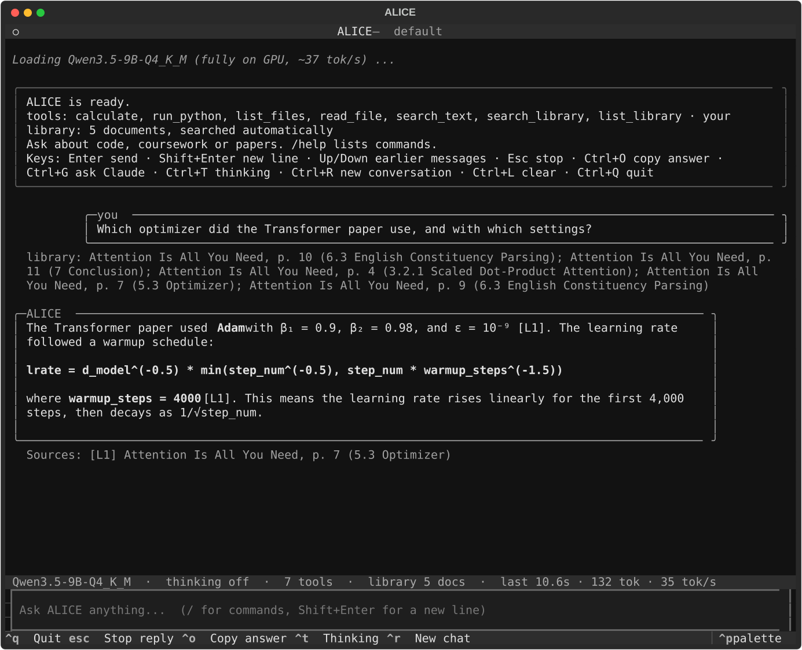

# ALICE

A locally run AI mentor with a personality, for **coding, coursework and research** in computer science and
AI. She gives you the full solution first, walks you through it step by step, and finishes with one concrete
question to check you got it. Expect a little sass about the topic, never about you. Bachelor thesis project;
the running notes, measurements and decisions are in [docs/DEVLOG.md](docs/DEVLOG.md).



## What she does

- **Runs on your own GPU.** Qwen3.5-9B through llama.cpp. Conversations, papers and memory stay on your
  computer.
- **Answers from your papers.** `alice ingest` adds PDFs and notes to a local library (hybrid vector +
  keyword search). Answers cite passages as `[L1]`, and ALICE warns about citations that were never retrieved
  and about numbers that aren't in the cited passages. Nicknames like "the ResNet paper" work.
- **Checks her own work.** A calculator for every non-trivial number, a check that the final answer matches
  it, and a warning when a reply claims a search or test run that never happened.
- **Stays honest about what she doesn't know.** Unknown papers or methods get "I don't know this one" instead
  of a confident made-up summary. She then looks it up with her arXiv tool, or does that automatically before
  answering if you turn on `/arxiv auto on`.
- **Remembers you.** Long conversations are compacted instead of forgotten. Facts you mention about yourself
  (courses, projects, deadlines, how you like explanations) are saved locally and used in later sessions.
  Facts that aren't backed by your own words are rejected.
- **Knows when to ask for help.** When her answer fails one of the checks, ALICE offers to pass the question
  to Claude (optional, opt-in). You see exactly what would be sent and what it costs before anything leaves
  your computer.
- **Fast enough to talk to.** About 1 s median to the first word in a multi-turn chat. That's down from 21 s
  before prompt caching was fixed: see the 2026-11-19 entry in the devlog.

## Quick start (Windows)

1. Get the llama.cpp CUDA build into `tools/llama.cpp/` (see the devlog, Phase 0), then the models:
   `bash scripts/download_models.sh` (Qwen3.5-9B Q4_K_M 5.7 GB + Qwen3-Embedding-0.6B 0.6 GB).
2. Python 3.11+:
   ```
   python -m venv .venv
   .venv\Scripts\python -m pip install -e ".[dev]"          # add ,claude for /claude: ".[dev,claude]"
   ```
3. Chat:
   ```
   .venv\Scripts\alice tui                   # chat box (full-screen terminal UI); starts the model itself
   .venv\Scripts\alice                       # line-based chat (same options)
   ```

## Use

```
.venv\Scripts\alice tui --think           # thinking mode on (slower, best at maths and logic)
.venv\Scripts\alice tui --workspace C:\code\proj   # let ALICE read files in that folder (default: current dir)
.venv\Scripts\alice tui --offline         # no internet tools (arXiv)
.venv\Scripts\alice tui --no-memory       # don't load or save long-term memory this session
.venv\Scripts\alice tui --claude          # allow /claude this session (needs an Anthropic API key)
.venv\Scripts\alice ingest papers\        # add PDFs / .md / .txt to your library
.venv\Scripts\alice library               # list library documents (--remove ID, --retitle ID TITLE)
```

**Chat box keys.**
- Sending and editing: Enter sends, Shift+Enter starts a new line, Up/Down brings back earlier messages.
- During a reply: Esc stops it. The status line shows what ALICE is doing and for how long.
- Answers: Ctrl+O copies the last answer. Ctrl+G asks Claude.
- Chat: Ctrl+T toggles thinking, Ctrl+R starts a new conversation, Ctrl+L clears the screen, PgUp/PgDn
  scrolls, Ctrl+Q quits.

Typing `/` shows the commands. Use Windows Terminal or the VS Code terminal (the old console window renders
it poorly).

**Commands (both chats).**

| Command | What it does |
|---|---|
| `/think on\|off` | step-by-step reasoning |
| `/arxiv auto on\|off` | automatic arXiv lookup for named papers |
| `/claude [question]` | pass the last question, or a new one, to Claude |
| `/memory` | show what ALICE remembers about you |
| `/remember TEXT` | add a note to long-term memory |
| `/forget ID\|all` | delete memory notes |
| `/copy [code]` | copy the last answer or its last code block (chat box only) |
| `/tools` | list the tools |
| `/reset` | start a new conversation |
| `/help` | show the commands |
| `/quit` | leave |

**Tools.**
- `calculate`
- `run_python`, which asks before running
- `list_files` / `read_file` / `search_text`: read-only, and only inside the workspace
- `arxiv_search` / `arxiv_paper`: use the internet
- `search_library` / `list_library`: available once your library has documents

### Memory

ALICE keeps notes in `data/memory/memory.db`, on your computer only. Notes are written in three situations:
- when a long conversation is compacted (the oldest turns are summarised to keep the rest in context)
- on `/reset`
- when the chat closes, which takes a few seconds; Ctrl+C skips it

A note is either something you said about yourself, or a short summary of what a conversation covered. The
newest notes are loaded at the next start.

You stay in control: `/memory` lists the notes, `/forget` deletes them, and `--no-memory` or
`[memory] enabled = false` turns memory off.

### Claude escalation (optional)

For questions the local model is too weak for, ALICE can hand over to Claude. It is off unless you turn it on.
1. Install the extra: `pip install -e ".[claude]"`.
2. Set `ANTHROPIC_API_KEY`.
3. Set `[claude] enabled = true` in `alice.toml`, or start ALICE with `--claude`.

How it works:
- **Suggestion.** When an answer fails a check, ALICE says why and suggests `/claude`. These checks are
  citations that were never retrieved, numbers that aren't in the cited passages, a calculator mismatch, a
  claimed search that never happened, a tool loop, or "I don't know this paper".
- **Confirmation.** `/claude` (or Ctrl+G) shows exactly what would be sent and an estimated cost, and asks
  first. Paths, e-mail addresses and anything that looks like a key are redacted, and memory notes are never
  sent.
- **Answer.** Claude answers in ALICE's voice, and the conversation then continues locally.
- **Usage log and budget.** Usage goes to `logs/claude_usage.jsonl`: tokens, cost and the reason, never
  message text. A monthly budget, $5 by default, is enforced from that log.
- **Model.** The default is `claude-opus-5-5` at `effort = "high"`, with Anthropic's refusal fallback
  enabled.

## Configuration and hardware upgrades

All hardware-specific settings live in `alice.toml`, which is not committed. Start from the example:
`copy alice.example.toml alice.toml`. The defaults target a small consumer GPU: Qwen3.5-9B at 16k context,
with the embedder on the CPU.

To upgrade:
1. Download the bigger model into `models/` and add a profile, e.g. `[models.big]` with `gguf`, `ctx`, `ngl`
   and `extra_args`. Then set `[chat] profile = "big"`, or run `alice --model big`.
2. With spare VRAM or unified memory, set `[embedding] device = "gpu"`.
3. If you change the embedding model, run `alice library --rebuild`, then
   `python scripts/calibrate_retrieval.py`, and copy the suggested thresholds into `[embedding]`. ALICE
   refuses to mix embedding models in one library and tells you when a rebuild is needed.

ALICE works on Windows, macOS and Linux (llama.cpp's `llama-server`; `.exe` is added automatically on
Windows).

The paper library uses exact vector search plus SQLite FTS5. In `scripts/scale_bench.py` one search took
about 19 ms at 100k chunks (about 1,000 papers) and about 185 ms at 1M chunks (about 10,000 papers).

## Privacy

Everything runs locally, with two optional exceptions:
- the arXiv tools, which send the search text to arxiv.org
- `/claude`, which sends what it showed you to Anthropic, and only after you say yes

Your data stays in gitignored folders: sessions in `logs/transcripts/`, the library in `data/library/` and
memory in `data/memory/`.

## Tests and evaluations

```
.venv\Scripts\python -m pytest                                   # unit + headless UI tests (no model needed)
.\scripts\bench.ps1 -Model Qwen3.5-9B-Q4_K_M                     # raw speed (llama-bench)
.venv\Scripts\python scripts\latency_bench.py --tag NAME          # time to first token in a real conversation
.venv\Scripts\python scripts\memory_eval.py                       # memory: planted facts stored and used
.venv\Scripts\python scripts\phase1_check.py                      # numeric accuracy + opener variety
set ALICE_LIBRARY=data\eval_library
.venv\Scripts\alice ingest data\eval_papers                       # 5 arXiv papers (download: see DEVLOG)
.venv\Scripts\python scripts\rag_eval.py --set famous             # retrieval + grounded answers (also: 2026, alias, calc)
.venv\Scripts\python scripts\scale_bench.py                       # vector search at 10k-1M chunks
.venv\Scripts\python scripts\calibrate_retrieval.py --set 2026    # thresholds for the embedding model
.venv\Scripts\python scripts\readme_screenshot.py                 # the screenshot above, from the real model
```

## Contributing

This is a personal thesis project, so pull requests aren't accepted. You're welcome to read the code and the
devlog.
